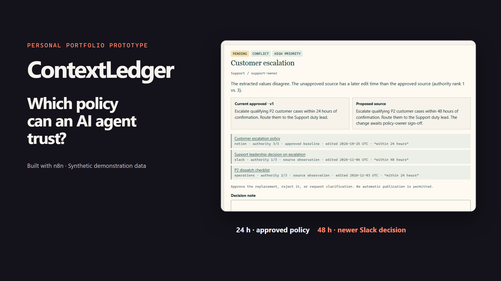
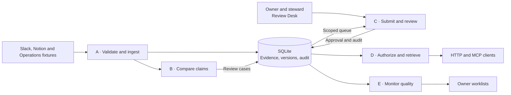
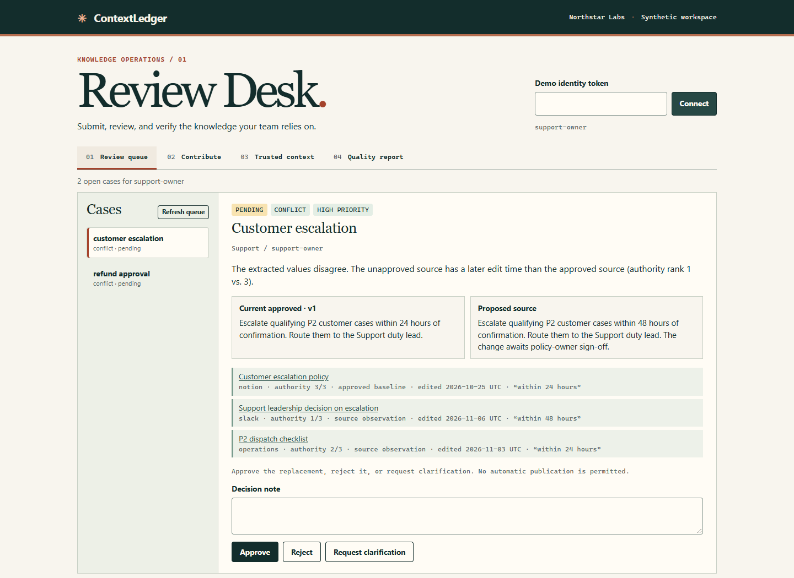
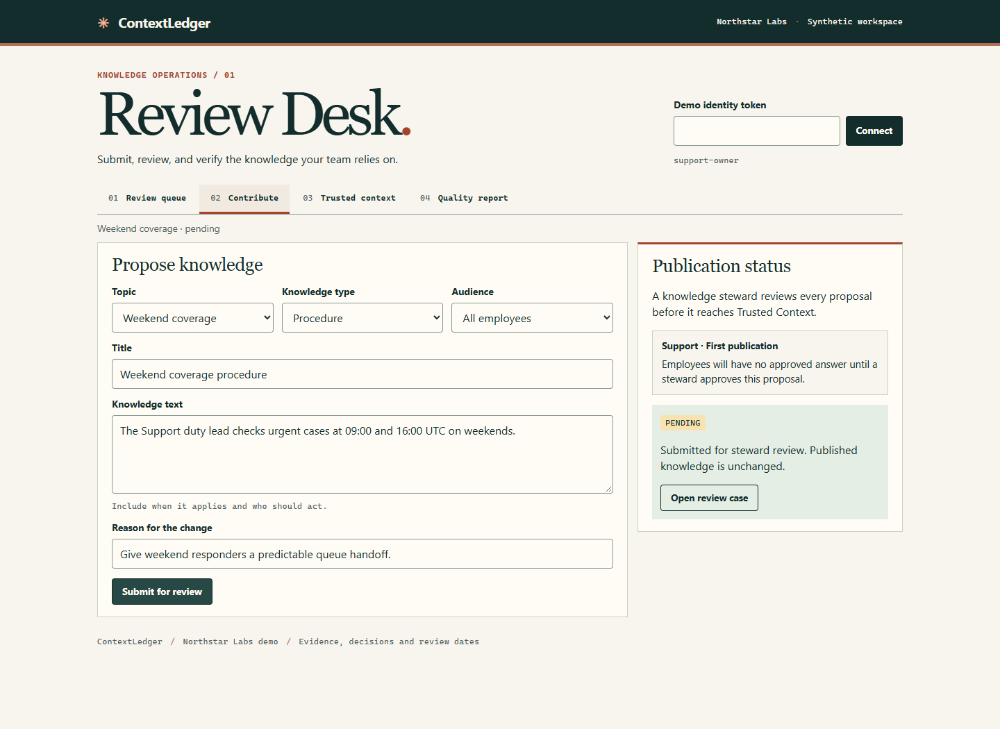
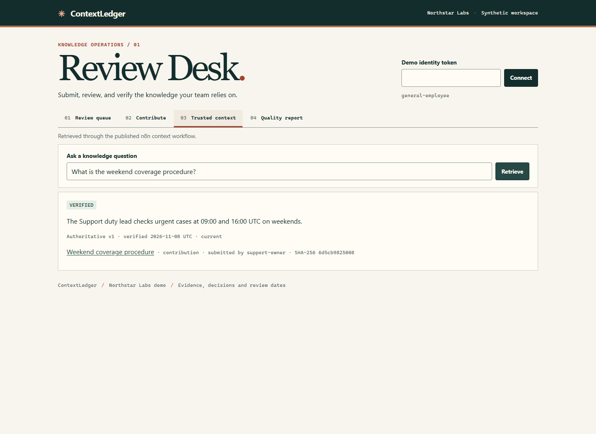
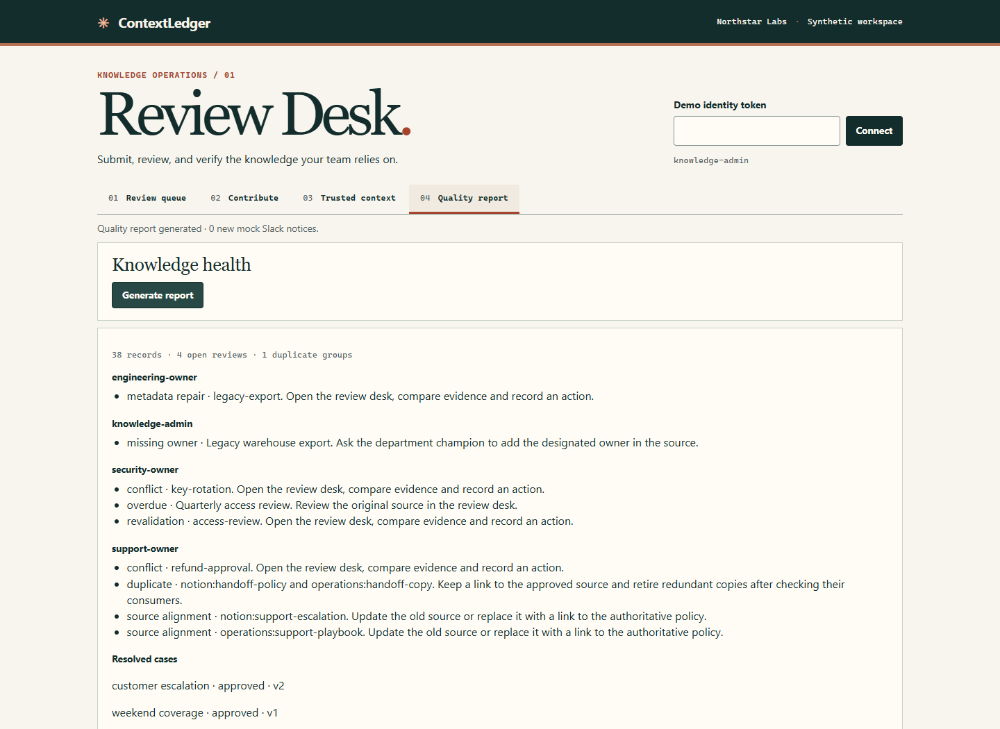

# ContextLedger

Five n8n workflows for governing the knowledge AI agents retrieve.

At Northstar Labs, the approved Support policy says to escalate within 24 hours. A newer Slack decision says 48. The dispatch checklist still says 24. ContextLedger keeps the 24-hour policy in force while the Support owner reviews the evidence. After approval, employees and agents get the 48-hour policy with its version, source and verification date.

[90-second demo (MP4)](https://github.com/lmrnc/contextledger/releases/download/v1.0.0/ContextLedger_Demo_90s.mp4) · [Complete project ZIP](https://github.com/lmrnc/contextledger/releases/download/v1.0.0/ContextLedger_All_Deliverables.zip) · [Run locally](#run-locally)

[](https://github.com/lmrnc/contextledger/releases/download/v1.0.0/ContextLedger_Demo_90s.mp4)

The demo follows the escalation review, then a department owner submitting a weekend coverage procedure. The same employee query abstains before steward approval and returns a cited answer after it. The footage shows the working Review Desk and n8n editor, with English captions and AI-generated narration.

[Walkthrough script](DEMO.md) · [English subtitles](video/ContextLedger_Demo_90s.srt) · [Editable video](video/README.md)

## How it works

n8n validates incoming records against a shared taxonomy and routes conflicting claims to their owner. SQLite keeps source observations, approved versions and audit events. Department owners use the Review Desk to submit procedures or propose revisions. A separate steward approves their submissions. HTTP and MCP use the same retrieval workflow and permission checks.



| Review a conflict | Propose a procedure |
| --- | --- |
| [](evidence/pending-conflict.png) | [](evidence/contributor-submission.png) |
| **Retrieve a cited answer** | **Assign follow-up work** |
| [](evidence/contributor-retrieval.png) | [](evidence/quality-report.png) |

## Run locally

The verified Windows x64 setup uses Node.js 24, npm, PowerShell and Python 3. Run these commands from the project directory.

```powershell
npm.cmd install --prefix .runtime --no-save --ignore-scripts --no-audit --no-fund n8n@2.46.6 @modelcontextprotocol/sdk@1.29.0 zod@3.25.76
.\scripts\install-windows-sqlite.ps1
npm.cmd start
```

Once **ContextLedger ready** appears, run `npm.cmd run seed` and `npm.cmd run tokens` in another terminal. Open the [Review Desk](http://127.0.0.1:5680) and follow the [walkthrough](DEMO.md). Run `npm.cmd test` for the isolated suites. [Full setup, reset commands, Compose and MCP client instructions](docs/SETUP.md)

## Verification and limits

On a clean Windows x64 setup with Node.js 24.14.0 and n8n 2.46.6, 19 end-to-end scenarios, four policy tests and one scheduler test passed. An MCP SDK client exercised retrieval with two identities. Compose configuration passed validation. The Docker engine timed out before a container run could be verified. [Test output, API responses and workflow canvases](evidence/README.md)

Northstar Labs, its 37 records and its Slack, Notion and Operations feeds are synthetic. The monitor writes reminders to a mock Slack outbox. Retrieval uses curated topic aliases and exact source evidence.

The demo binds to loopback and uses generated bearer tokens. It filters answers and citations by caller permissions and blocks self-approval. Production would require SSO, source ACL synchronization and revocation, TLS, scoped storage access and durable notification delivery.

[Technical architecture](ARCHITECTURE.md) · [Contributor guide](CONTRIBUTOR_GUIDE.md) · [Design brief](PORTFOLIO.md)
